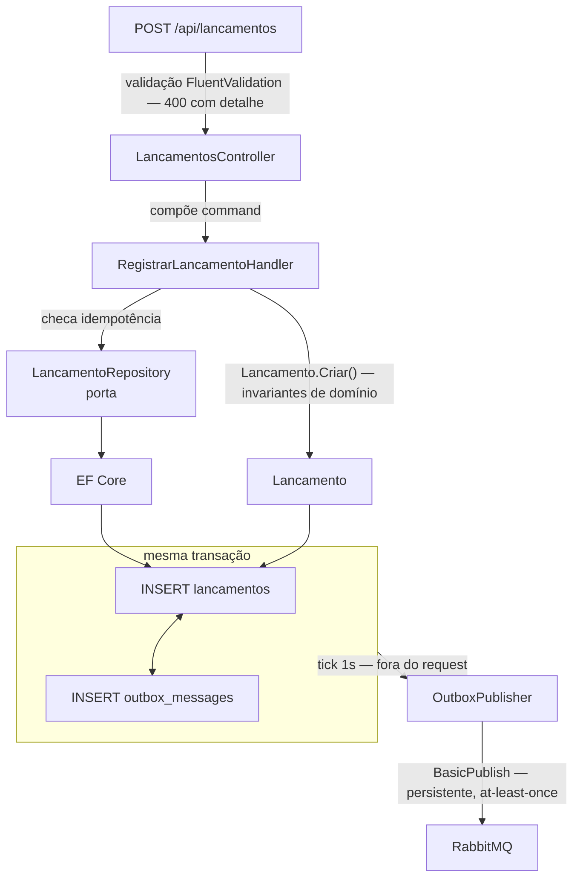
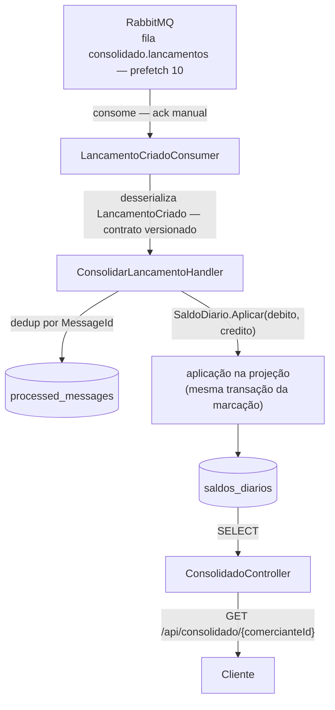

# 04 — Arquitetura Alvo (desenho completo)

> Representação visual em 4 níveis C4 + runtime de falha: [c4/arquitetura-c4.html](../c4/arquitetura-c4.html)

## C4 — Nível 1: Contexto

O sistema **Fluxo de Caixa** serve o **Comerciante** (pessoa, ou sistema de ponto de venda/PDV que
integra via API). Dois fluxos: registrar lançamentos e consultar saldo consolidado.

## C4 — Nível 2: Containers

| Container | Tecnologia | Papel | Comunicação |
|---|---|---|---|
| API Lançamentos | ASP.NET Core (minimal API) | Aceitar lançamentos (critical path) | REST/JSON entrada; RabbitMQ saída (via outbox) |
| Outbox Publisher | BackgroundService (.NET) | Drenar eventos pendentes → broker (at-least-once) | RabbitMQ |
| RabbitMQ | 3.13 (management) | Desacoplamento: exchange durável + fila + DLQ | AMQP/JSON |
| Worker Consolidado | BackgroundService (.NET) | Projetar eventos → read model; dedup; retry→DLQ | RabbitMQ entrada; PostgreSQL |
| API Consolidado | ASP.NET Core (minimal API) | Relatório read-only | REST/JSON entrada; PostgreSQL (SELECT) |
| PostgreSQL 16 | Banco único | `lancamentos`, `outbox_messages`, `saldos_diarios`, `processed_messages` | N/A |
| DbInit | Job efêmero (.NET) | Criar schema no 1º boot (EnsureCreated; migrations em produção) | PostgreSQL |

## C4 — Nível 3: Componentes de L1 (API Lançamentos)

Regra de dependência: `Controller → Handler → Domínio ← Repository` — portas definidas na
camada Application, implementadas na Infrastructure. O domínio não conhece EF nem RabbitMQ.

## C4 — Nível 3: Componentes do lado Consolidado

## Fluxo de dados (happy path)

1. `POST /api/lancamentos` → valida → checa índice único `(comercianteId, idempotencyKey)`.
2. **Transação única:** `INSERT lancamentos` + `INSERT outbox_messages` → commit → 201.
3. OutboxPublisher (tick 1 s) publica `LancamentoCriado` (persistent, `MessageId` = id do outbox) e marca `Processado`.
4. Consumer projeta no read model e grava `processed_messages` **na mesma transação** → `BasicAck`.
5. `GET /api/consolidado/{id}?inicio&fim` lê `saldos_diarios` (O(1) por dia) e responde com total do período.

## Modelo de dados

| Tabela | Domínio | Papel | Restrições |
|---|---|---|---|
| `lancamentos` | Lançamentos | Fonte da verdade | PK Id; **UK (ComercianteId, IdempotencyKey)**; índice (ComercianteId, Data) |
| `outbox_messages` | Lançamentos | Eventos pendentes | índice (Processado, OcorridoEmUtc) |
| `saldos_diarios` | Consolidado | Read model | PK (ComercianteId, Data) |
| `processed_messages` | Consolidado | Dedup | PK (MessageId) |

## Padrões aplicados e onde cada um resolve um problema real

| Padrão | Problema que resolve | Ponto do fluxo |
|---|---|---|
| Transactional Outbox | Consistência entre gravação e notificação sem 2PC | transação do registro |
| CQRS (read model) | Relatório O(1) por dia; leitura não bloqueia escrita | saldos_diarios |
| Event-driven (broker) | Isolamento de falha entre domínios | toda a integração |
| Idempotência dupla | Reenvio de cliente e reentrega do broker | API + consumer |
| Dead Letter Queue | Mensagens irrecuperáveis auditáveis | RabbitMQ |
| Retry com backoff | Falhas transitórias | consumer |

## Por que NÃO outros estilos (resumo — ver ADR-001)

| Estilo | Veredito |
|---|---|
| **Monolito** (mesmo modular) | Violaria o RNF: consolidação quebraria o registro junto |
| **SOA clássico (ESB)** | Barramento central = single point of failure e acoplamento; maturidade e custo desproporcionais |
| **Serverless** | Cold start e ops desnecessários a 50 rps; mensageria de retry vira código custom |
| **Microsserviços finos + sincronia** | Chamada síncrona reintroduz a dependência que o RNF proíbe |
| **Microsserviços event-driven (2 serviços)** | Isolamento por construção; escala independente; broker como amortecedor |

## Topologia do broker

- Exchange `fluxocaixa.events` (fila dedicada `consolidado.lancamentos`, durável, DLX configurada).
- **Fanout** hoje: um consumidor; evoluir para **topic** quando novos tipos de evento/consumidores surgirem — troca de configuração, não de código, assegurando extensibilidade nativa.

## Características de evolução (flexibilidade e reusabilidade)

- **Novo consumidor** (conciliação, notificação, BI): novo binding no exchange — zero mudança em Lançamentos.
- **Novo evento** (`LancamentoEstornado`): novo tipo no contrato; projeção avança paraversionamento.
- **Troca de broker/banco**: portas na Application isolam a infraestrutura (ADR-002/003).
